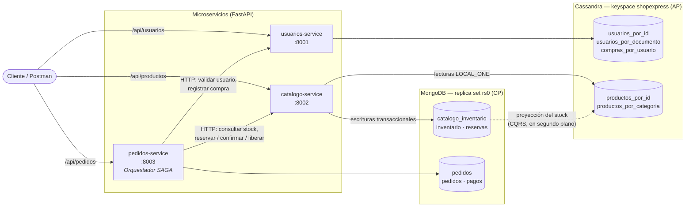
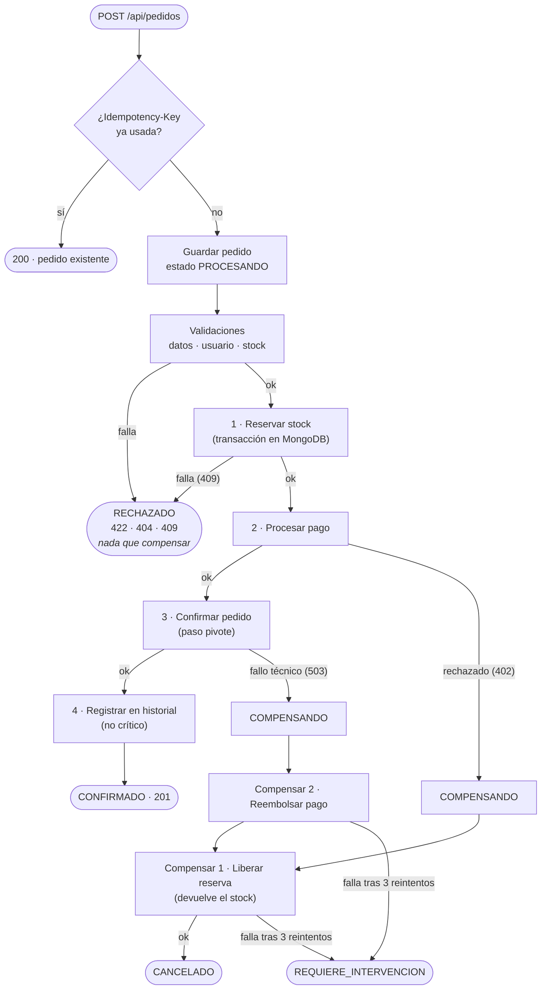
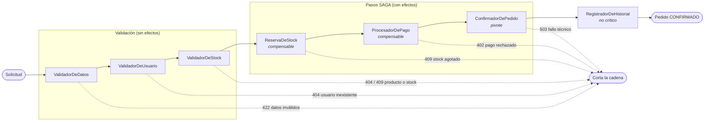

# NoSQL Tarea 2 2026 — ShopExpress

Sistema de microservicios para la plataforma ficticia de comercio electrónico **ShopExpress**.
Tres servicios en **Python + FastAPI**, dos bases NoSQL (**Cassandra** y **MongoDB**), un **orquestador SAGA**
que procesa cada pedido a través de una **Chain of Responsibility**, y **CQRS** para el stock.

| Servicio | Puerto | Swagger | Base de datos | Responsabilidad |
|---|---|---|---|---|
| `usuarios-service` | 8001 | [localhost:8001/docs](http://localhost:8001/docs) | Cassandra | Perfiles, direcciones, historial de compras, exportación seudonimizada |
| `catalogo-service` | 8002 | [localhost:8002/docs](http://localhost:8002/docs) | Cassandra (lectura) + MongoDB (stock) | Productos, categorías, precios, inventario y reservas |
| `pedidos-service` | 8003 | [localhost:8003/docs](http://localhost:8003/docs) | MongoDB | Pedidos y pagos; orquestador SAGA + Chain of Responsibility |

Con el sistema levantado, cada servicio tiene su documentación interactiva (Swagger) en `/docs`: desde ahí se
pueden probar todos los endpoints en el navegador (ver [Probar desde el navegador](#probar-desde-el-navegador-swagger)).

---

## Contenido

1. [Arquitectura](#1-arquitectura)
2. [Justificación del diseño](#2-justificación-del-diseño)
3. [Patrón SAGA](#3-patrón-saga-orquestada)
4. [Chain of Responsibility](#4-chain-of-responsibility)
5. [Funcionalidad opcional: CQRS y seudonimización](#5-funcionalidad-opcional)
6. [Cómo construir, levantar y probar](#6-cómo-construir-levantar-y-probar)
7. [Referencia de endpoints](#7-referencia-de-endpoints)
8. [Estructura del repositorio](#8-estructura-del-repositorio)

---

## 1. Arquitectura



- Cada servicio es dueño de sus datos: **ningún servicio accede a la base de otro**. Pedidos se comunica con
  Usuarios y Catálogo solo por HTTP.
- El servicio de Pedidos es el **orquestador**: los otros dos no saben que participan de una SAGA, solo
  exponen operaciones (reservar, confirmar, liberar, registrar compra).
- Docker Compose levanta todo con `healthcheck` y `depends_on`: los servicios arrancan recién cuando las
  bases están listas y el contenedor `cassandra-init` creó el esquema.

---

## 2. Justificación del diseño

### 2.1 Teorema CAP: qué prioriza cada parte del sistema

La consigna pide **disponibilidad en la lectura** (AP) y **consistencia en la escritura de pedidos** (sin
sobreventa). Ninguna base sola resuelve bien las dos cosas, así que se usa una para cada necesidad:

| Necesidad | Prioridad CAP | Base | Por qué |
|---|---|---|---|
| Leer catálogo y perfiles (muchas lecturas, tráfico alto) | **AP** | Cassandra | Arquitectura sin maestro: cualquier nodo responde; escala horizontal lineal; lecturas por clave de partición muy rápidas. Tolera nodos caídos a costa de devolver datos levemente desactualizados. |
| Escribir pedidos, pagos y descontar stock | **CP** | MongoDB | Transacciones ACID multi-documento, `findOneAndUpdate` atómico con condición, `writeConcern`/`readConcern` `majority` y validación de esquema. Ante una partición rechaza escrituras en vez de aceptar datos inconsistentes. |

**¿Por qué el stock no está en Cassandra?** Cassandra no tiene un decremento condicional atómico barato:
los `counter` no admiten condiciones (no se puede decir "restá 1 solo si queda ≥ 1") y las *lightweight
transactions* (`IF stock >= ?`) usan Paxos, son lentas bajo contención y no abarcan varias filas a la vez.
Un pedido con varios productos necesita descontar todos o ninguno, y eso lo resuelve una transacción de
MongoDB. Por eso el stock **se escribe en MongoDB** y **se proyecta a Cassandra** para la lectura (ver CQRS).

### 2.2 Niveles de consistencia configurados

**Cassandra** (`usuarios-service` y `catalogo-service`):

| Operación | Nivel | Motivo |
|---|---|---|
| Lecturas (`GET` de usuario, producto, categoría) | `LOCAL_ONE` | Responde con una sola réplica: máxima disponibilidad y menor latencia (AP). |
| Escrituras | `LOCAL_QUORUM` | Durabilidad razonable sin depender de todas las réplicas. |
| Unicidad del documento del usuario | LWT `IF NOT EXISTS` + `LOCAL_SERIAL` | Evita dos usuarios con la misma cédula (única operación que necesita consenso). |
| Proyección del stock | `USING TIMESTAMP` | *Last-write-wins* por el momento en que se **leyó** el stock en Mongo: si dos sincronizaciones llegan desordenadas, gana la más reciente y no se pisa un valor nuevo con uno viejo. |

> Con un solo nodo en Docker (`SimpleStrategy`, RF 1) los niveles son equivalentes; en producción el keyspace
> usaría `NetworkTopologyStrategy` con RF 3 y entonces `LOCAL_ONE` vs. `LOCAL_QUORUM` sí marca la diferencia.
> El código ya usa los niveles correctos, así que solo cambia la configuración del keyspace.

**MongoDB** (`catalogo-service` para el stock y `pedidos-service`):

- Replica set `rs0` (de un nodo en Docker): es requisito para usar transacciones.
- `w="majority"` y `readConcern="majority"` en el cliente: una escritura confirmada no se pierde ante un
  failover, y nunca se lee algo que podría revertirse.
- Transacciones de reserva con `ReadConcern("snapshot")` y `WriteConcern("majority")`.

### 2.3 Cómo se garantiza que no haya sobreventa

Tres barreras independientes en el servicio de inventario (`catalogo-service/app/inventario.py`):

1. **Descuento condicional atómico:**
   `find_one_and_update({_id: producto, stock: {$gte: cantidad}}, {$inc: {stock: -cantidad}})`.
   El filtro y la resta se evalúan juntos sobre el documento, así que dos pedidos concurrentes no pueden
   leer "queda 1" y restar los dos.
2. **Transacción multi-documento:** la reserva y el descuento de todos los productos del pedido van en una
   misma transacción. Si un producto no alcanza, se aborta todo y no queda stock descontado a medias.
3. **Validador `$jsonSchema`** en la colección `inventario` con `stock >= 0`: aunque hubiera un bug en el
   código, MongoDB rechaza cualquier escritura que deje stock negativo.

**Prueba realizada:** 20 pedidos en paralelo contra un producto con stock 5 → **5 respuestas `201` y 15
respuestas `409`**, con el stock final en 0 tanto en MongoDB como en Cassandra.

Además, `POST /api/pedidos` acepta el header **`Idempotency-Key`**: si el cliente reintenta la misma
solicitud (por ejemplo, por un timeout), se devuelve el pedido existente con `200` en lugar de cobrar dos
veces. Lo respalda un índice único parcial en MongoDB.

### 2.4 Modelado: embebido vs. referencia

**MongoDB — colección `pedidos`** (un documento por pedido):

```json
{
  "_id": "ord_3f9a1c2b4d5e",
  "usuario_id": "usr_4708b2d08d36",
  "clave_idempotencia": "pedido-demo-001",
  "estado": "CONFIRMADO",
  "items": [
    { "producto_id": "prod_b267afb81e8a", "cantidad": 2, "precio_unitario": NumberDecimal("25.50") }
  ],
  "total": NumberDecimal("51.00"),
  "pago": { "metodo": "TARJETA_CREDITO", "estado_pago": "APROBADO", "transaccion_id": "tx_..." },
  "saga": [
    { "paso": "ValidadorDeDatos", "estado": "COMPLETADO", "detalle": "...", "fecha": ISODate("...") }
  ],
  "creado_en": ISODate("..."), "actualizado_en": ISODate("...")
}
```

| Dato | Decisión | Motivo |
|---|---|---|
| `items`, `pago`, log de la `saga` | **Embebido** | Pertenecen solo a ese pedido, se leen y escriben siempre juntos y su tamaño está acotado (máx. 20 items). Un solo documento = una sola escritura atómica, sin joins. |
| `precio_unitario` dentro del item | **Embebido (copia)** | Es una *foto* del precio al momento de comprar: si el catálogo cambia el precio después, el pedido no debe cambiar. |
| `usuario_id`, `producto_id` | **Referencia** | Pertenecen a otros servicios y otras bases; duplicar el perfil o la ficha del producto rompería el principio de "cada servicio es dueño de sus datos". |
| Colección `pagos` | **Colección separada** | La pasarela simulada necesita su propio índice único por `pedido_id` para que cobrar sea idempotente. |
| `reservas` (inventario) | **Colección separada** con `_id = pedido_id` | Permite liberar o confirmar la reserva de un pedido de forma idempotente. |

**Cassandra — modelado orientado a consultas.** En Cassandra no hay joins: se diseña **una tabla por
consulta** y se acepta duplicar datos (desnormalización):

| Tabla | Clave primaria | Consulta que resuelve |
|---|---|---|
| `usuarios_por_id` | `usuario_id` | `GET /api/usuarios/{id}` |
| `usuarios_por_documento` | `(tipo_documento, nro_documento)` | Unicidad del documento (LWT) |
| `compras_por_usuario` | `((usuario_id), fecha DESC, pedido_id)` | Historial de compras, más recientes primero |
| `productos_por_id` | `producto_id` | `GET /api/productos/{id}` (incluye el stock proyectado) |
| `productos_por_categoria` | `((categoria), producto_id)` | `GET /api/productos?categoria=...` |

- Las **direcciones** se embeben en el usuario como `list<frozen<direccion>>` (tipo definido por el usuario):
  son pocas y siempre se leen con el perfil.
- El **historial de compras** va en otra tabla, particionada por usuario y ordenada por fecha: crece sin
  límite, así que embeberlo haría crecer la fila del usuario indefinidamente.
- El producto se escribe en las dos tablas con un `BATCH` *logged*, para que ambas vistas queden alineadas.

---

## 3. Patrón SAGA (orquestada)

El **servicio de Pedidos es el orquestador central** (`pedidos-service/app/saga/orquestador.py`). Ejecuta los
pasos en orden, **guarda el estado del pedido en MongoDB después de cada paso** (así siempre se sabe en qué
punto quedó) y, si algo falla, ejecuta las **compensaciones de los pasos ya completados en orden inverso**.

| Paso | Servicio | Acción | Compensación |
|---|---|---|---|
| 1. Reservar stock | Catálogo/Inventario | `POST /api/inventario/reservas` | `DELETE /api/inventario/reservas/{id}` (devuelve el stock) |
| 2. Cobrar | Pasarela simulada (Pedidos) | `cobrar()` | `reembolsar()` |
| 3. Confirmar (**pivote**) | Catálogo/Inventario | `POST .../reservas/{id}/confirmar` | — (a partir de acá el pedido queda confirmado) |
| 4. Registrar historial | Usuarios | `POST /api/usuarios/{id}/compras` | — (no crítico: si falla, el pedido sigue válido) |



**Estados del pedido:**

| Estado | Significado |
|---|---|
| `PROCESANDO` | La SAGA está en curso. |
| `CONFIRMADO` | Todos los pasos terminaron bien. |
| `RECHAZADO` | Falló una validación antes de modificar nada en otro servicio: no hay nada que compensar. |
| `COMPENSANDO` | Falló un paso y se están deshaciendo los anteriores. |
| `CANCELADO` | Las compensaciones terminaron bien: el sistema quedó como antes del pedido. |
| `REQUIERE_INTERVENCION` | Una compensación falló 3 veces seguidas; queda registrado para revisión manual. |

**Decisiones de robustez:**

- **Compensaciones idempotentes:** liberar una reserva ya liberada o reembolsar un pago ya reembolsado no
  hace nada. Por eso se pueden **reintentar** (3 intentos con espera creciente) sin riesgo.
- **Paso pivote:** después de `ConfirmadorDePedido` la SAGA ya no vuelve atrás. El registro en el historial
  es posterior y no crítico: si Usuarios no responde, el pedido sigue confirmado y el historial queda
  eventualmente desactualizado (consistente con la prioridad AP de ese servicio).
- **Doble chequeo de stock:** `ValidadorDeStock` hace un chequeo previo con lectura consistente (para fallar
  rápido y tomar los precios), pero la garantía real es la reserva atómica: si otro pedido se llevó el stock
  entre medio, la reserva devuelve `409` y el pedido queda `RECHAZADO`.
- **Trazabilidad:** cada respuesta incluye el array `saga` con cada paso, su estado
  (`COMPLETADO`, `FALLIDO`, `COMPENSADO`, `COMPENSACION_FALLIDA`), un detalle y la fecha.

**Cómo provocar cada camino en la demo:**

| Escenario | Cómo se provoca | Resultado |
|---|---|---|
| Éxito | Pedido válido | `201` · `CONFIRMADO` |
| Reintento | Repetir con la misma `Idempotency-Key` | `200` · mismo pedido |
| Datos inválidos | `cantidad: 0` | `422` · `RECHAZADO` |
| Usuario inexistente | `usuario_id` que no existe | `404` · `RECHAZADO` |
| Sin stock | Cantidad mayor al stock | `409` · `RECHAZADO` |
| Pago rechazado | `metodo_pago: "TARJETA_RECHAZADA"` o total > 5000 | `402` · `CANCELADO` (se libera la reserva) |
| Fallo al confirmar | Header `X-Simular-Fallo: confirmacion` | `503` · `CANCELADO` (se reembolsa el pago y se libera la reserva) |

---

## 4. Chain of Responsibility

Cada pedido recorre una cadena de manejadores (`pedidos-service/app/chain/`). Todos heredan de la clase
abstracta `Manejador`, comparten un `ContextoPedido` (items, total, pago, log de pasos) y deciden si
**pasan la solicitud al siguiente** o **la cortan** lanzando `PedidoRechazadoError` con el código HTTP que
corresponde.



| Manejador | Qué verifica / hace | Si falla |
|---|---|---|
| `ValidadorDeDatos` | Usuario presente, entre 1 y 20 items, cantidades entre 1 y 100, sin productos repetidos, método de pago válido | `422` |
| `ValidadorDeUsuario` | El usuario existe (consulta al servicio de Usuarios) | `404` |
| `ValidadorDeStock` | Cada producto existe y hay stock (lectura consistente); toma el precio del catálogo y calcula el total | `404` / `409` |
| `ReservaDeStock` | Reserva y descuenta el stock en una transacción | `409` |
| `ProcesadorDePago` | Cobra el total con la pasarela simulada | `402` |
| `ConfirmadorDePedido` | Confirma la reserva y marca el pedido como `CONFIRMADO` | `503` |
| `RegistradorDeHistorial` | Agrega la compra al historial del usuario | No corta la cadena |

**Cómo se integra con la SAGA:** el método `manejar()` de la clase base ejecuta el paso, lo registra en el
log y, si el manejador es `compensable`, lo agrega a la lista de pasos a deshacer. Cuando un manejador corta
la cadena, el orquestador recorre esa lista **al revés** llamando a `compensar()` de cada uno. Así la
cadena define el **orden** de los pasos y el orquestador decide **qué hacer cuando algo falla**.

```text
pedidos-service/app/chain/base.py         → Manejador (enlazar, manejar, procesar, compensar) y ContextoPedido
pedidos-service/app/chain/manejadores.py  → los 7 manejadores y construir_cadena()
pedidos-service/app/saga/orquestador.py   → OrquestadorSaga (ejecución, compensaciones y reintentos)
```

Agregar una regla nueva (por ejemplo, un `ValidadorDeFraude`) es crear una clase que herede de `Manejador`
y enlazarla en `construir_cadena()`, sin tocar los demás manejadores ni el orquestador.

---

## 5. Funcionalidad opcional

Se implementaron dos de las opciones del punto 4 de la consigna.

### 5.1 CQRS en el catálogo e inventario

- **Lado de escritura (comandos):** el stock vive en MongoDB (colecciones `inventario` y `reservas`). Toda
  modificación (crear producto, reservar, liberar) pasa por ahí, con transacciones.
- **Lado de lectura (consultas):** la ficha del producto, con el stock, se lee de Cassandra
  (`productos_por_id`), con `LOCAL_ONE`.
- **Proyección:** después de cada reserva o liberación, una tarea en segundo plano (`BackgroundTasks` de
  FastAPI) lee el stock de MongoDB y lo escribe en Cassandra con `USING TIMESTAMP`. La respuesta al cliente
  no espera a la proyección: por eso la lectura es **eventualmente consistente**.
- La respuesta de `GET /api/productos/{id}` indica de dónde salió el stock en el campo `fuente_stock`. Con
  `?consistente=true` el stock se lee directamente de MongoDB; esa es la lectura que usa el
  `ValidadorDeStock`.

### 5.2 Seudonimización en la exportación de usuarios

`GET /api/usuarios/exportar?formato=json|csv` devuelve los usuarios **sin datos personales identificables**,
pensado para análisis o para compartir con terceros:

| Campo original | Exportado como | Técnica |
|---|---|---|
| `id` | `id_seudonimo` (`anon_` + 16 hex) | **HMAC-SHA256** con clave secreta (`PSEUDONIMO_CLAVE`) |
| `nombre` | `nombre_inicial` (ej. `J.`) | Generalización |
| `apellido` | — | Eliminado |
| `email` | `email_enmascarado` (ej. `j***@correo.com`) | Enmascarado |
| `direcciones` | `ciudades` | Generalización (se descartan calle y código postal) |
| `tipo_documento`, `nro_documento` | — | Eliminado |
| `creado_en` | `fecha_alta` (solo la fecha) | Reducción de precisión |

Se usa HMAC (y no un hash simple) porque el seudónimo es **estable** (el mismo usuario tiene siempre el
mismo seudónimo, así se pueden cruzar exportaciones) pero **no se puede revertir** sin la clave: con un
SHA-256 sin clave, alguien podría recalcular los hashes de todos los ids posibles.

---

## 6. Cómo construir, levantar y probar

### Requisitos

- Docker Desktop con Docker Compose v2.
- Unos 3 GB de RAM libres (Cassandra está limitada a 512 MB de heap).
- Opcional: Postman, para importar la colección de [`postman/`](postman/).

### Construir y levantar

```powershell
# Construye las imágenes de los 3 servicios y levanta todo en segundo plano
docker compose up -d --build

# Ver el estado: los servicios tienen que figurar como "healthy"
# (Cassandra tarda entre 1 y 2 minutos la primera vez; cassandra-init figura como "Exited (0)", es normal)
docker compose ps

# Ver los logs de un servicio
docker compose logs -f pedidos-service
```

### Probar con Postman

1. Importar `postman/ShopExpress.postman_collection.json`.
2. Ejecutar las carpetas **en orden** (o la colección completa con el *Collection Runner*). Las primeras
   requests guardan en variables de la colección el id del usuario y los ids de los productos, y las
   siguientes los usan.
3. Cada request tiene tests que verifican el código HTTP y el estado esperado del pedido.

### Probar desde el navegador (Swagger)

Con el sistema levantado, abrir en el navegador (copiar y pegar la dirección si el enlace no abre):

| Servicio | Swagger |
|---|---|
| Usuarios | <http://localhost:8001/docs> |
| Catálogo e Inventario | <http://localhost:8002/docs> |
| Pedidos y Pagos | <http://localhost:8003/docs> |

1. Desplegar un endpoint, tocar **Try it out**, completar el JSON del cuerpo y tocar **Execute**.
2. La respuesta aparece abajo, con el código HTTP y el cuerpo.
3. Los ids que devuelve un servicio (usuario, producto) hay que copiarlos a mano en el pedido.
4. En `POST /api/pedidos`, los headers `Idempotency-Key` y `X-Simular-Fallo` aparecen como campos opcionales
   arriba del cuerpo. Si se dejan vacíos, el pedido se procesa normalmente.

> Swagger descarga su interfaz desde `cdn.jsdelivr.net`: si la página queda en blanco, revisar la conexión a
> internet o desactivar el bloqueador de anuncios. Si el navegador no encuentra `localhost`, probar con
> `http://127.0.0.1:8003/docs`.

#### Header `Idempotency-Key`: evitar pedidos duplicados

Protege contra los reintentos del cliente. Por ejemplo: el usuario toca "Comprar", el pago pasa, pero se corta
la conexión antes de recibir la respuesta y la app reintenta. Sin este header se crearía un segundo pedido y se
cobraría dos veces. El cliente manda un identificador único por intento de compra (cualquier texto) y el
servicio lo guarda con un índice único en MongoDB.

**Cómo llenarlo en Swagger** (`POST /api/pedidos` → *Try it out*):

| Campo | Valor |
|---|---|
| `idempotency-key` | `compra-prueba-001` |
| `x-simular-fallo` | *(vacío)* |
| Cuerpo | `{ "usuario_id": "<id del usuario>", "metodo_pago": "TARJETA_CREDITO", "items": [ { "producto_id": "<id del producto>", "cantidad": 1 } ] }` |

**Qué pasa:**

1. **Primer *Execute*:** `201 Created`, pedido `CONFIRMADO`, se descuenta 1 de stock y se cobra.
2. **Segundo *Execute* con la misma clave:** `200 OK` con **el mismo `pedido_id`**. No se crea otro pedido,
   no se descuenta stock y no se cobra de nuevo.
3. **Con otra clave (por ejemplo `compra-prueba-002`):** se crea un pedido nuevo (`201`).

Si dos reintentos con la misma clave llegan exactamente al mismo tiempo, el índice único hace que solo uno se
guarde y el otro recibe el pedido existente.

#### Header `X-Simular-Fallo`: forzar las compensaciones de la SAGA

Es una herramienta de **demo**, no algo que usaría un cliente real. Hace fallar a propósito el paso
`ConfirmadorDePedido`, es decir, **después** de reservar el stock y de cobrar, que es el peor caso: hay que
deshacer dos pasos.

**Cómo llenarlo en Swagger:**

| Campo | Valor |
|---|---|
| `idempotency-key` | *(vacío, o una clave nueva)* |
| `x-simular-fallo` | `confirmacion` (en minúscula y sin tilde; otro valor da `422`) |
| Cuerpo | El mismo de arriba, por ejemplo con `"cantidad": 3` |

**Qué pasa:**

1. Respuesta `503 Service Unavailable` con el pedido en estado **`CANCELADO`** y `pago.estado_pago` en
   **`REEMBOLSADO`**.
2. En el array `saga` se ven los pasos completados, el `ConfirmadorDePedido` en `FALLIDO` y las
   compensaciones **en orden inverso**:
   ```text
   ReservaDeStock        COMPLETADO   Stock reservado en inventario
   ProcesadorDePago      COMPLETADO   Pago aprobado (tx_...)
   ConfirmadorDePedido   FALLIDO      Fallo simulado al confirmar el pedido (header X-Simular-Fallo)
   ProcesadorDePago      COMPENSADO   Pago reembolsado (tx_...)
   ReservaDeStock        COMPENSADO   Reserva liberada, stock devuelto al inventario
   ```
3. El stock vuelve al valor anterior: se puede comprobar con `GET /api/productos/{id}?consistente=true`.

El header funciona solo porque el `docker-compose.yml` define `SIMULACION_FALLOS_HABILITADA: "true"`. En
producción la variable iría en `false` y el header se ignoraría, para que nadie pueda provocar fallos desde afuera.

### Probar desde PowerShell

```powershell
# 1. Crear un usuario
$usuario = Invoke-RestMethod -Method Post -Uri http://localhost:8001/api/usuarios -ContentType "application/json" -Body (@{
    tipo_documento = "CI"; nro_documento = "45678901"; nombre = "Ana"; apellido = "Gómez"
    email = "ana@correo.com"
    direcciones = @(@{ calle = "Av. 18 de Julio 1234"; ciudad = "Montevideo"; codigo_postal = "11100" })
} | ConvertTo-Json -Depth 5)

# 2. Crear un producto con stock 10
$producto = Invoke-RestMethod -Method Post -Uri http://localhost:8002/api/productos -ContentType "application/json" -Body (@{
    nombre = "Auriculares"; descripcion = "Bluetooth"; categoria = "audio"; precio = 59.90; stock = 10
} | ConvertTo-Json)

# 3. Crear un pedido (camino exitoso)
$pedido = Invoke-RestMethod -Method Post -Uri http://localhost:8003/api/pedidos -ContentType "application/json" `
    -Headers @{ "Idempotency-Key" = "demo-001" } -Body (@{
    usuario_id = $usuario.id; metodo_pago = "TARJETA_CREDITO"
    items = @(@{ producto_id = $producto.id; cantidad = 2 })
} | ConvertTo-Json -Depth 5)
$pedido.estado              # CONFIRMADO
$pedido.saga | Format-Table paso, estado, detalle

# 4. Ver el stock: eventual (Cassandra) y consistente (MongoDB)
Invoke-RestMethod http://localhost:8002/api/productos/$($producto.id)
Invoke-RestMethod "http://localhost:8002/api/productos/$($producto.id)?consistente=true"

# 5. Ver el historial de compras del usuario
(Invoke-RestMethod http://localhost:8001/api/usuarios/$($usuario.id)).historial_compras

# 6. Exportación seudonimizada
Invoke-RestMethod http://localhost:8001/api/usuarios/exportar
```

Para ver los casos de error (4xx/5xx) desde PowerShell 5.1, `Invoke-RestMethod` lanza una excepción; el
código se lee con `$_.Exception.Response.StatusCode`. Para esos casos es más cómodo usar Postman.

> **Nota sobre acentos en PowerShell 5.1:** si en la consola aparece `Pérez` en vez de `Pérez`, es un
> problema de cómo PowerShell 5.1 decodifica la respuesta, no de los datos: en la base y en Postman se ven bien.

### Inspeccionar las bases

```powershell
# Cassandra: ver el producto y su stock proyectado
docker compose exec cassandra cqlsh -e "SELECT producto_id, nombre, stock_disponible FROM shopexpress.productos_por_id;"

# MongoDB: ver el stock real y el último pedido
docker compose exec mongo mongosh --quiet catalogo_inventario --eval "db.inventario.find().toArray()"
docker compose exec mongo mongosh --quiet pedidos --eval "db.pedidos.find().sort({creado_en:-1}).limit(1).toArray()"
```

### Detener

```powershell
# Detiene y elimina los contenedores; los datos se conservan en los volúmenes
docker compose down

# Además borra los volúmenes (PERDÉS TODOS LOS DATOS de Cassandra y MongoDB; no es reversible)
docker compose down -v
```

---

## 7. Referencia de endpoints

### Usuarios — `http://localhost:8001` · [Swagger](http://localhost:8001/docs)

| Método | Ruta | Descripción | Respuestas |
|---|---|---|---|
| `POST` | `/api/usuarios` | Crear usuario | `201`, `409` documento duplicado, `422` |
| `GET` | `/api/usuarios/{id}` | Perfil + direcciones + historial de compras | `200`, `404` |
| `GET` | `/api/usuarios/exportar?formato=json\|csv` | Exportación seudonimizada | `200` |
| `POST` | `/api/usuarios/{id}/compras` | Registrar compra (uso interno de la SAGA) | `201`, `404` |

### Catálogo e Inventario — `http://localhost:8002` · [Swagger](http://localhost:8002/docs)

| Método | Ruta | Descripción | Respuestas |
|---|---|---|---|
| `POST` | `/api/productos` | Crear producto con stock inicial | `201`, `422` |
| `GET` | `/api/productos/{id}?consistente=false\|true` | Producto con stock (eventual o consistente) | `200`, `404` |
| `GET` | `/api/productos?categoria=...` | Listar productos de una categoría | `200` |
| `POST` | `/api/inventario/reservas` | Reservar stock (SAGA) | `201`, `200` idempotente, `404`, `409` |
| `GET` | `/api/inventario/reservas/{pedido_id}` | Ver una reserva | `200`, `404` |
| `POST` | `/api/inventario/reservas/{pedido_id}/confirmar` | Confirmar reserva (SAGA) | `200`, `404`, `409` |
| `DELETE` | `/api/inventario/reservas/{pedido_id}` | Liberar reserva (compensación) | `200`, `404` |

### Pedidos y Pagos — `http://localhost:8003` · [Swagger](http://localhost:8003/docs)

| Método | Ruta | Descripción | Respuestas |
|---|---|---|---|
| `POST` | `/api/pedidos` | Crear pedido (inicia la SAGA). Headers opcionales: `Idempotency-Key`, `X-Simular-Fallo: confirmacion` | `201`, `200`, `402`, `404`, `409`, `422`, `503` |
| `GET` | `/api/pedidos/{id}` | Ver pedido con el log de la SAGA | `200`, `404` |

---

## 8. Estructura del repositorio

```text
.
├── docker-compose.yml
├── infra/
│   ├── cassandra/init.cql          # keyspace, tipo direccion y tablas
│   └── mongo/init-replica.js       # inicia el replica set rs0 (usado como healthcheck)
├── usuarios-service/app/
│   ├── main.py                     # endpoints
│   ├── repository.py               # acceso a Cassandra
│   ├── anonimizacion.py            # seudonimización HMAC y enmascarado
│   └── models.py · db.py
├── catalogo-service/app/
│   ├── main.py                     # endpoints + proyección CQRS
│   ├── repository.py               # modelo de lectura (Cassandra)
│   ├── inventario.py               # modelo de escritura: stock y reservas (MongoDB)
│   └── models.py · db.py
├── pedidos-service/app/
│   ├── main.py                     # endpoints, idempotencia
│   ├── chain/                      # Chain of Responsibility
│   ├── saga/orquestador.py         # orquestador SAGA
│   ├── clientes.py                 # clientes HTTP a Usuarios y Catálogo
│   ├── pagos.py                    # pasarela de pago simulada
│   └── repository.py · models.py · db.py
└── postman/ShopExpress.postman_collection.json
```
